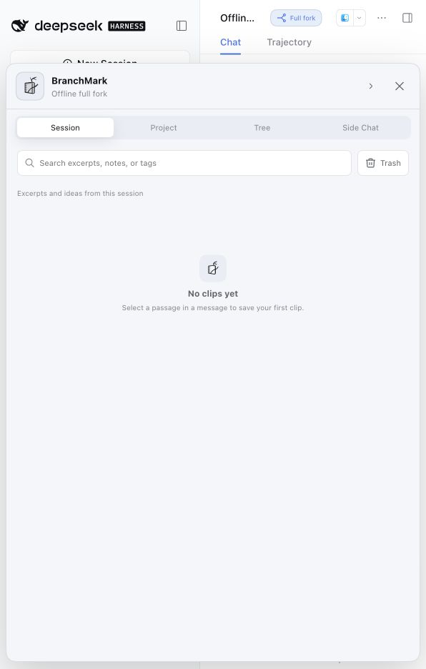
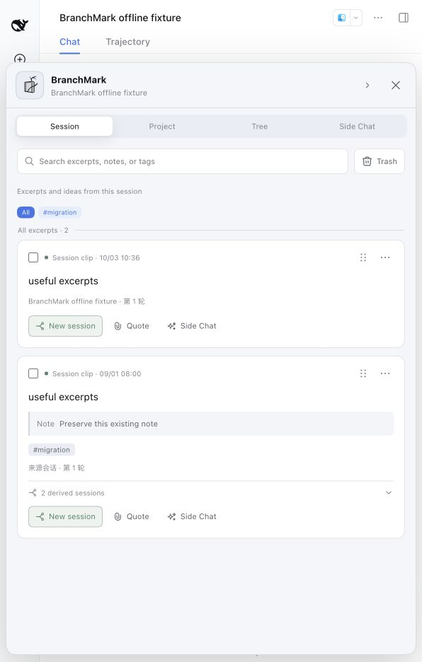
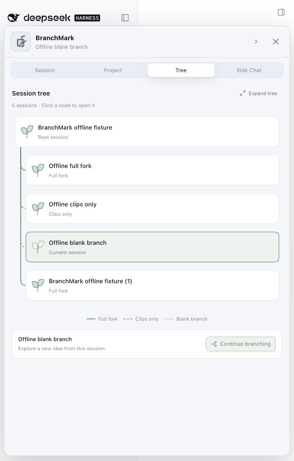

# npm DSH 0.2.0-rc.2 适配与验收

2026-10-03，本地候选 BranchMark `0.2.0-rc.1` 在 npm DSH `0.2.0-rc.2` 的 Web profile 中完成离线试配。插件候选尚未发布到 npm；已发布的 BranchMark `0.1.2-rc.2` 仍对应 DSH `0.1.2-rc.1`。本次按用户要求不使用模型，实际浏览器使用固定会话记录，工具与流式取消使用受控 adapter。

## 版本与环境

| 项目 | 验收值 |
| --- | --- |
| 工作分支 | `codex/branchmark-dsh-0.2.0-rc.2` |
| BranchMark 起点 | `1cee35d`，本次适配从此提交开始 |
| BranchMark 候选 | `0.2.0-rc.1`，四份 manifest 一致 |
| DSH npm 目标 | `0.2.0-rc.2`；查询时 `latest` 和 `next` 指向此版本 |
| DSH release commit | `639ed015397290b3745d163aafe02ffee4aa3f84`，[官方 release](https://github.com/deepseek-ai/deepseek-harness/releases/tag/dsh-v0.2.0-rc.2) |
| 工具链 | macOS，Node `22.22.2`，源码 pnpm `11.7.0`，DSH profile pnpm `11.1.3` |
| 运行隔离 | npm CLI、Web profile、工作区和存储均位于专用临时目录；未升级日常 DSH home |
| 浏览器 | Codex in-app browser，真实 npm Web 服务；使用 DSH 的 in-page directory-picker overlay |

DSH master 和 npm release 必须分别判断。2026-10-08 复核时，本地 DSH checkout 为 `0.2.1-alpha.1`（`5badb15`），npm `latest` 仍为 `0.2.0-rc.2`；这次构建只使用 npm 包和对应 release API，没有通过父仓库 workspace 路径混用 master。

## 适配内容

| 集成点 | 当前实现 |
| --- | --- |
| 发布依赖 | catalog、generator、peers/dev dependencies 和 lockfile 精确固定到 DSH `0.2.0-rc.2` |
| 持久读取 | [`readPersistedSession`](../../../packages/host/src/persisted-session.ts) 集中执行 `open(id, 'read') → read() → finally close()` |
| 已保存 Clip | Host 激活时以 SessionId/MessageId 唯一定位，复核 role、turn、原文区间和 excerpt；保留内容、备注、标签与时间，只更新来源位置和 forkable |
| 无法确认的来源 | 保留 Clip，并禁用完整分叉；真实迁移/介质错误在激活时传播，不作为缺失来源忽略 |
| 完整分叉 | Host `prepareFork` 返回完整轮次的 inclusive `atSeq`，Client 再调用 DSH exact-prefix fork，记录关系时仍严格校验 parent、seeded 位和实际继承长度 |
| Session 生命周期 | `sessions.using` 保留异步操作，等待 `reference.ready` 后记录/命名/发送；会话树保留原 id，不重新创建会话 |
| Client 导航 | 当前会话从 `byId` 的 `retainedBy.mainView` 读取，界面跳转使用 `uiWorkspace.openSession` |
| UI 图标 | 使用 DSH Medium 导出，替换已移除的带尺寸导出名 |
| 模型消息协议 | 插件 source 使用 `dsh-branchmark` 声明合并；工具结果以独立 `role='tool'` 消息和 `toolCallId` 关联 |

## 实际 Web 结果

固定记录包含一轮已完成对话、Markdown 加粗文本、两个在旧格式保存的 Clip、已有备注和标签。来源为合成数据，未包含真实用户会话。

| 场景 | 结果 | 证据 |
| --- | --- | --- |
| tarball 安装与装载 | PASS | 精确 npm CLI 安装本地包并启动 Web；实际安装包包含 15 个 Remote 方法 |
| V1 日志读取与旧 Clip | PASS | 旧 assistant eventSeq `9 → 6`，user `4 → 5`；excerpt、note、tags、createdAt/updatedAt 保留 |
| 日志代际 | PASS | 打开来源后生成 `session.v4.jsonl`；原 V1 保留，验收前后 SHA-256 为 `0fec11560cac6a47564389e07c94fd2ff2c9ebf26d7d78b97659c86a6b2738c3` |
| 旧版 BranchMark recall | PASS | 单独 V1 fixture 的旧 `kind=plugin, plugin=dsh-branchmark` 由 DSH 迁移为 `kind=plugin:dsh-branchmark`；消息 ID、recall form、正文与备注保留，真实 Client 可打开 |
| 真实文本选择 | PASS | 在渲染后的 `useful excerpts` 加粗文本上拖选，出现四种操作；保存后 Session 集合从 1 枚变为 2 枚 |
| 引用和刷新恢复 | PASS | Quote 插入原生 Chip；刷新显示“已恢复 1 枚枝签引用”，来源仍为 1 turn / 1 step，未自动发送 |
| Full fork | PASS | 成功打开命名子会话；落盘含原 user/assistant、完整 turn/end 和一条所选材料 recall；原生 parent 指向来源 |
| Clips only | PASS | 成功打开命名子会话；落盘只有所选材料 recall，无继承消息、无原生 parent、无新 turn/start |
| Blank branch | PASS | 成功打开命名子会话；落盘没有消息或 recall，无原生 parent、无新 turn/start |
| 会话树与重开 | PASS | 三种组织关系可见；点击仅枝签节点重开原会话，刷新后仍保持相同身份和树 |
| Side Chat UI | PASS | 创建临时页签并关闭，关闭后显示无临时 Side Chat；未发送问题 |
| Fixture 重现 | PASS | [`smoke-fixtures.mjs`](../../../scripts/smoke-fixtures.mjs) 在第二个隔离 home 生成 V1 + 两个 Clip，真实 npm Host 启动后得到相同 `9 → 6`、`4 → 5` 锚点 |

DSH 原生侧边栏会省略未提问会话；仅枝签和空白分支通过 BranchMark 会话树仍可读取标题并重开。树截图也包含复验前产生的一个原生子会话；该子会话因旧截断位置被 Host 拒绝写入 BranchMark 关系，保留在隔离环境作为失败证据。







## 自动化检查

以下命令在 BranchMark 根目录、支持的 Node 版本下执行。以下为本次最终结果：Host 24、Client 66、Bundle 1，共 91 项插件测试；测试数量以 runner 输出为准。

| 命令 | 结果 |
| --- | --- |
| `pnpm run typecheck` | PASS |
| `pnpm run test` | PASS，91 项 |
| `pnpm run build` | PASS |
| `pnpm run verify:bundle` | PASS |
| `pnpm run verify:release` | PASS |
| `pnpm run verify:docs` | PASS |
| `pnpm run verify:brand` | PASS |
| `pnpm peers check` | PASS |
| `pnpm exec publint packages/bundle` | PASS，无错误；保留 DSH lazy-CJS 浏览器入口的已知警告 |
| `git diff --check` | PASS |

Host 的 read-handle 测试覆盖成功和失败后的 close；缺失或重复的来源身份不能开启完整分叉。精确 fork 回归测试直接调用 DSH SessionStore：消息位置截断的 child 被拒绝，`prepareFork` 返回位置的 child 被接受。

[`side-chat-tools.spec.ts`](../../../packages/host/tests/side-chat-tools.spec.ts) 使用真实 DSH 本地文件 provider、隔离文件、受控 Web provider 和流式 adapter，覆盖 `project_read/project_list/project_search/web_search/web_fetch`、项目外路径与未授权写工具拒绝、工具结果在下一轮请求中的独立 tool role、结果在 snapshot 中的关联，以及回答取消和关闭。它验证协议和本地行为，不证明真实网络或模型可用性。

## 重现安装

从本仓库根目录构建，并使用专用临时 home：

```sh
pnpm install --frozen-lockfile
pnpm run build
pnpm run pack:bundle
BRANCHMARK_TRIAL_ROOT="$(mktemp -d)"
BRANCHMARK_TRIAL_HOME="$BRANCHMARK_TRIAL_ROOT/home"
BRANCHMARK_TRIAL_RUNTIME="$BRANCHMARK_TRIAL_ROOT/runtime"
npm install --prefix "$BRANCHMARK_TRIAL_RUNTIME" @deepseek-ai/dsh@0.2.0-rc.2
DSH_HOME="$BRANCHMARK_TRIAL_HOME" "$BRANCHMARK_TRIAL_RUNTIME/node_modules/.bin/dsh" plugin --profile web add "$(pwd)/dist/dsh-branchmark-0.2.0-rc.1.tgz"
DSH_HOME="$BRANCHMARK_TRIAL_HOME" "$BRANCHMARK_TRIAL_RUNTIME/node_modules/.bin/dsh" --profile web --no-open --port 0
```

替换同路径同版本 tarball 时，profile 包管理器可能复用缓存。必须重建、移除该试配 profile 的插件、重新安装，并核对已安装 JS 的新方法后重启；日志中的“Already up to date”不能证明已加载新文件。

固定记录生成器不读取凭据或调用模型，只接受系统临时目录下的 home，需要已创建的合成 Workspace 和一条已持久化 Session 来确定存储目录；home 中不能已有 `clip_explorer` domain。关闭该 home 的 Host 后执行 `node scripts/smoke-fixtures.mjs <runtime> <home> <project>`，再启动时把生成的 `offline-fixture.overlay.yml` 作为全局 `--patch` 参数放在 `--profile web` 之前。脚本只写合成记录，不调用模型。

## 未执行范围

- 遵照用户“不使用模型”的要求，未执行真实 provider 的摘要、回答和模型触发的工具链；这些不作为本次试配的阻塞项。
- 真实 Web 搜索/抓取网络服务未验收，受控 provider 只验证结果协议。
- 未启动 Electron Desktop、Windows 或 Linux，不据此声明桌面和跨平台实测通过。
- 未验证日志降级、跨系统提交故障恢复、后续 master API 或任意其他 DSH 版本。
- 未发布 npm 包；Git 提交、PR 和合并状态以 GitHub 仓库为准。

2026-10-03 验收 tarball 的 SHA-256 为 `e9fa04ae15b2b512c498fdf6da5666bd7a9c2e1ee37e49dfeab7c86e758a8416`。该产物的 `index.js/client.js/typert.host.js/typert.remote-client.js` 与完成浏览器验收的安装包逐字节一致；该 tarball 还包含当时更新后的版本与安装说明。
